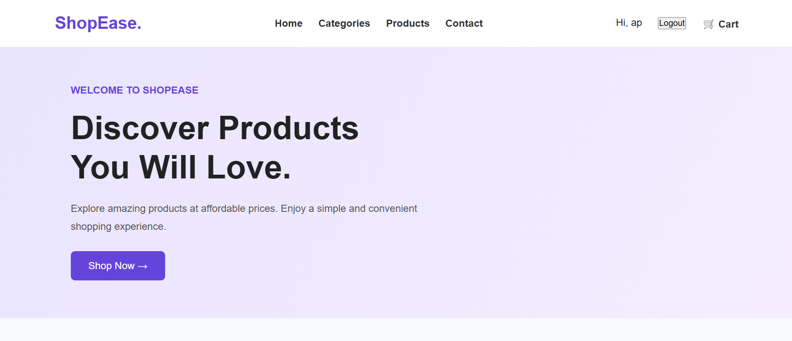
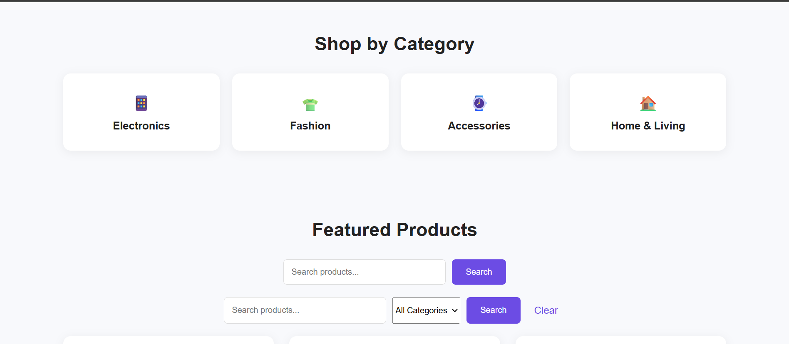
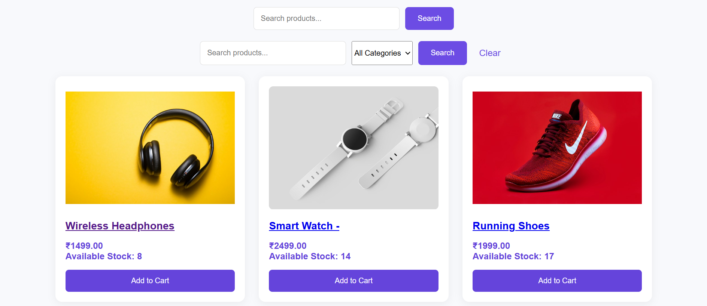
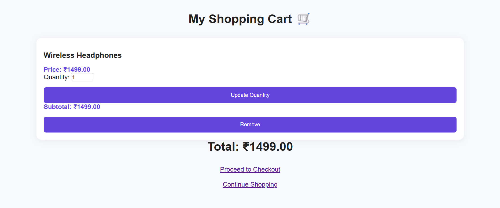
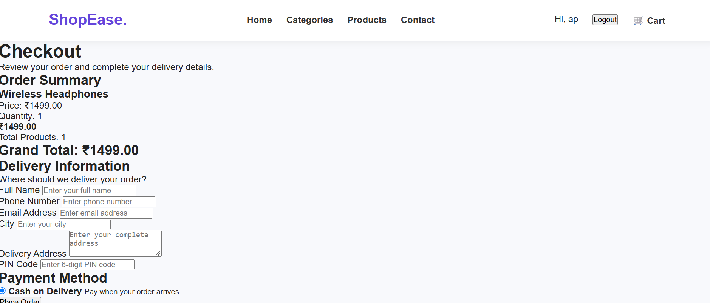
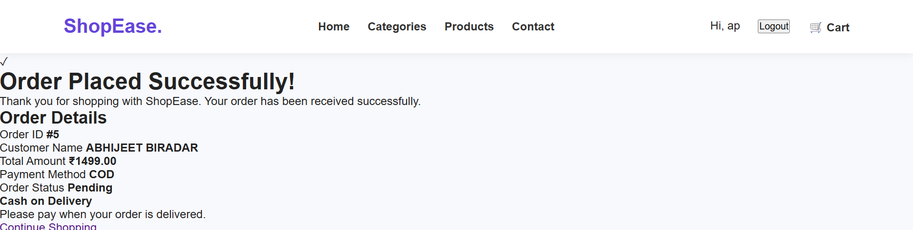
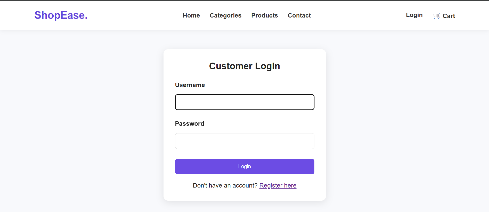
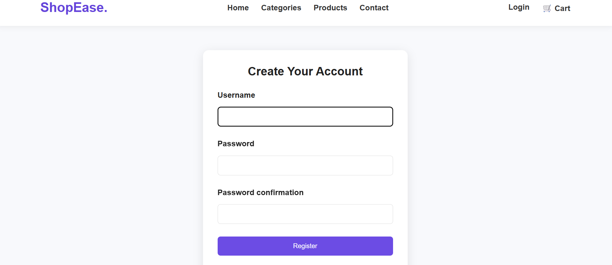

# 🛒 ShopEase – E-Commerce Website

ShopEase is a Django-based e-commerce web application that provides users with an online shopping experience. Users can explore products, browse categories, manage their shopping cart, and place orders through a simple and user-friendly interface.

## 🚀 Features

- User Registration and Login
- Product Browsing
- Product Categories
- Shopping Cart Management
- Checkout System
- Order Placement
- Order Confirmation
- User-Friendly Interface

## 🛠️ Technologies Used

- **Backend:** Python, Django
- **Frontend:** HTML, CSS, JavaScript
- **Database:** SQLite
- **Version Control:** Git and GitHub

## 📸 Project Screenshots

### 1. Homepage


### 2. Categories


### 3. Products


### 4. Shopping Cart


### 5. Checkout


### 6. Order Confirmation


### 7. Login


### 8. Registration


## ⚙️ Installation and Setup

1. Clone the repository:

   ```bash
   git clone https://github.com/Abhijeeto1/CodeAlpha_EcommerceStore.git
   ```

2. Navigate to the project directory:

   ```bash
   cd CodeAlpha_EcommerceStore
   ```

3. Create a virtual environment:

   ```bash
   python -m venv venv
   ```

4. Activate the virtual environment:

   **Windows:**
   ```bash
   venv\Scripts\activate
   ```

5. Install dependencies (if `requirements.txt` is available):

   ```bash
   pip install -r requirements.txt
   ```

6. Apply database migrations:

   ```bash
   python manage.py migrate
   ```

7. Start the development server:

   ```bash
   python manage.py runserver
   ```

8. Open your browser and visit:

   ```text
   http://127.0.0.1:8000/
   ```

## 👨‍💻 Developed As

This project was developed as part of the **CodeAlpha Internship Program**.

## 🔗 GitHub Repository

[ShopEase – E-Commerce Website](https://github.com/Abhijeeto1/CodeAlpha_EcommerceStore)

---

**Thank you for visiting ShopEase!**
